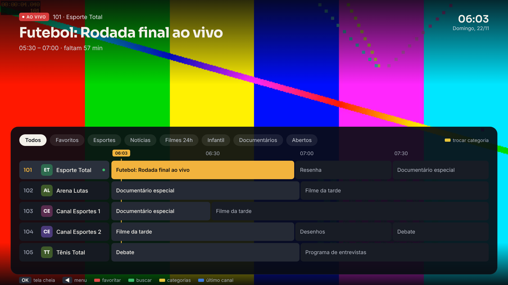
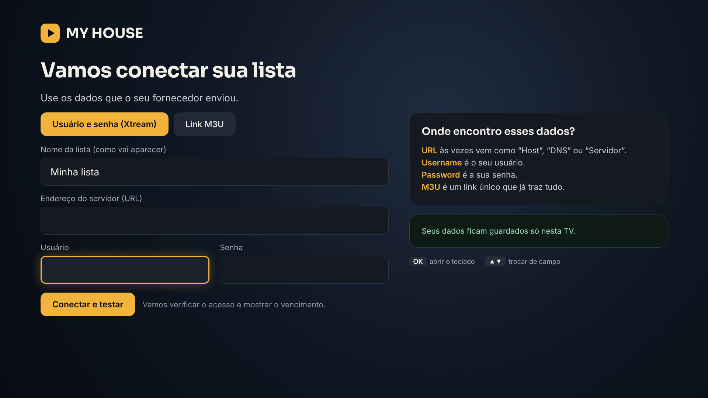
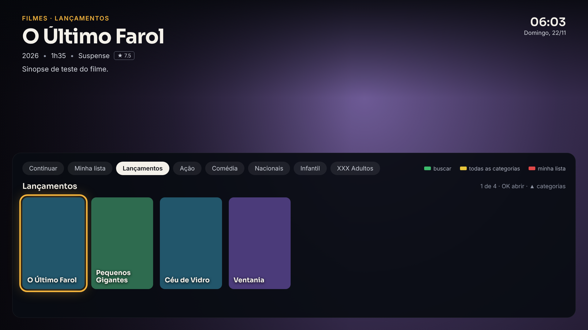
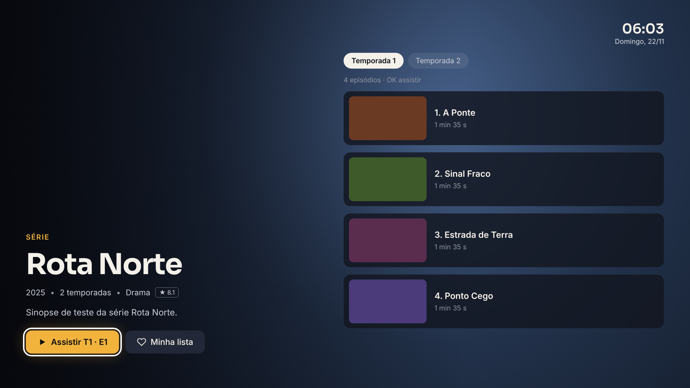
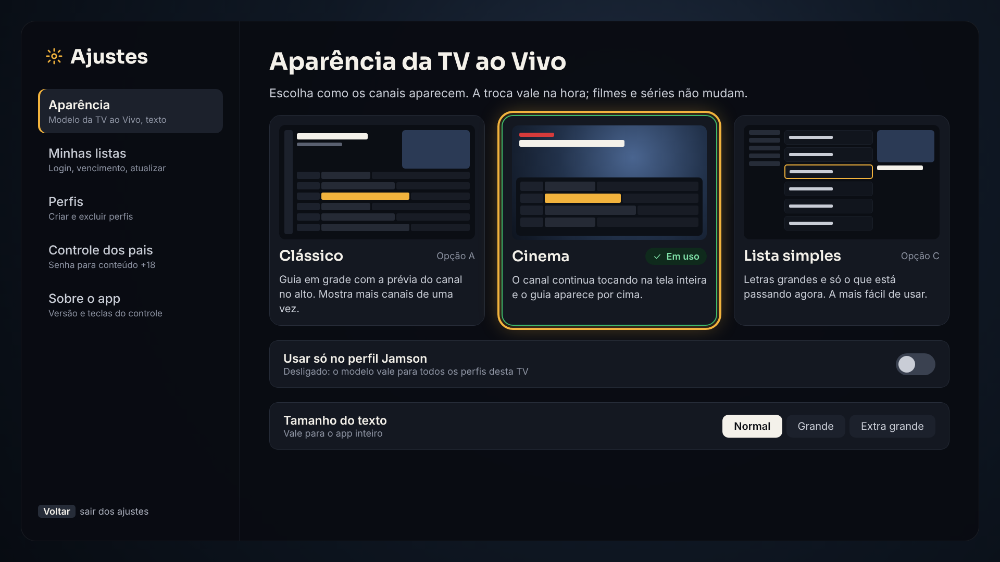
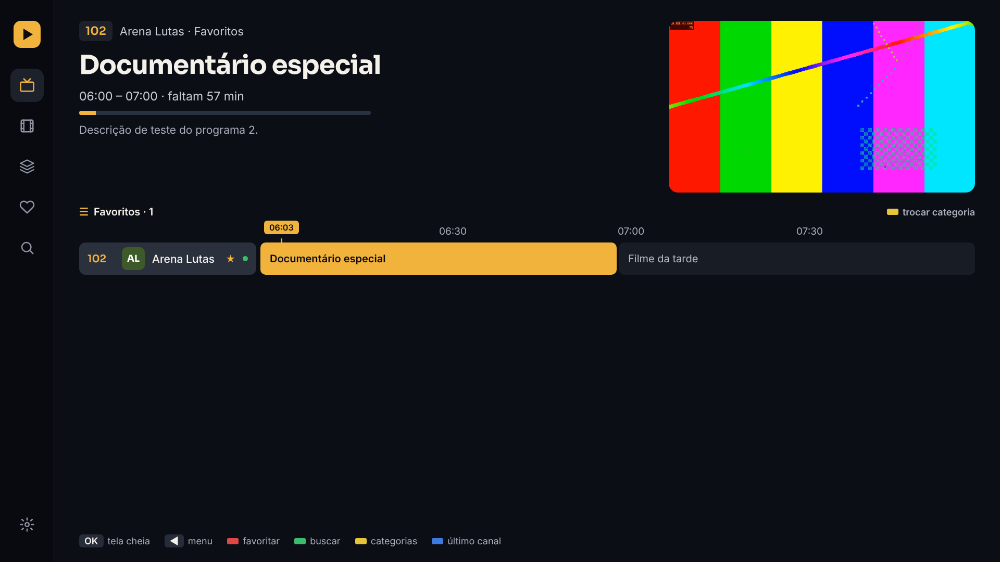

# MY HOUSE — player de IPTV para TV LG (webOS) e computador

App próprio para assistir a uma lista IPTV paga (login **Xtream Codes** ou **link M3U**) na TV LG, com visual inspirado no TiviMate e uso simples pelo controle remoto. O mesmo app também roda no computador (Windows), no Chrome em tela cheia.

> O app **não traz nenhum canal, filme ou série**. Ele só toca o conteúdo da lista que você já assina com o seu fornecedor.



## O que ele faz

- **TV ao vivo** com guia de programação (EPG), em três modelos de tela que você escolhe em Ajustes:
  - **Clássico:** guia em grade e prévia do canal no alto.
  - **Cinema:** o canal ocupa a tela inteira e o guia aparece por cima.
  - **Lista simples:** letras grandes e só o que está passando agora.
- Trocar de canal com as setas ou digitando o número, voltar ao último canal, favoritos e troca rápida de categoria.
- **Filmes e séries:**
  - Capas, sinopse, temporadas e episódios.
  - **Continuar de onde parou**, **Minha lista** e próximo episódio automático.
- **Busca** em canais, filmes e séries.
- **Perfis**, incluindo um perfil infantil que só mostra conteúdo infantil.
- **Controle dos pais:**
  - Categorias e títulos para maiores de 18 anos pedem uma senha de 4 dígitos (padrão `1234`).
  - A senha pode ser trocada em Ajustes.
- Tamanho do texto ajustável (normal, grande ou extra), troca de áudio e legenda, e várias listas.
- Funciona também em TVs LG mais antigas: o arquivo `compat.js` adapta o layout para o navegador antigo da TV.

| | |
|---|---|
|  |  |
|  |  |
|  |  |

Há mais telas em [`docs/telas`](docs/telas).

## Estrutura

```
app/            o app (HTML, CSS e JavaScript puro, sem framework)
  appinfo.json  manifesto do app webOS
  index.html
  css/app.css   layout 1920x1080
  js/
    util.js     utilidades, armazenamento local, teclas do controle, navegação
    compat.js   ajustes para o navegador antigo das TVs LG
    api.js      Xtream Codes (player_api.php) e leitura de listas M3U
    player.js   vídeo (HLS com hls.js, MP4), áudio e legendas
    app.js      telas, login, perfis, menu e busca
    pais.js     controle dos pais (senha para +18)
    live.js     TV ao vivo: 3 modelos e guia
    vod.js      filmes, séries e player
    ajustes.js  tela de Ajustes
  lib/hls.min.js
  fonts/        Inter e Sora (licença OFL)
pc/             versão para computador (servidor local + atalho)
tests/          servidor de lista falso, mídias de teste e testes automáticos
docs/telas/     capturas de tela
lista-config.example.json   modelo do arquivo com os dados da lista
```

## Dados da sua lista (`lista-config.json`)

Para o app já abrir conectado, sem digitar nada no controle, copie `lista-config.example.json` para `app/lista-config.json` e preencha **um** dos dois jeitos:

- **Xtream:** `servidor`, `usuario` e `senha`. Opcionalmente, `reservas` com outros endereços do mesmo fornecedor.
- **M3U:** só o `m3u`, com o link completo da lista.

Se o arquivo não existir ou estiver vazio, o app abre a tela de login normal.

> ⚠️ **Nunca publique o `lista-config.json`.** Ele tem o seu usuário e a sua senha. Ele já está no `.gitignore`.

Em `app/js/app.js`, você também pode preencher `SERVIDOR_PADRAO`, que deixa o campo de servidor pré-preenchido na tela de login.

## Instalar na TV LG

1. **Na TV:**
   1. Instale o app **Developer Mode** pela LG Content Store e entre com uma conta grátis de desenvolvedor da LG.
   2. Ligue **Dev Mode Status**; a TV reinicia.
   3. Depois, ligue **Key Server** e anote o IP da TV e a frase-chave (passphrase).
2. **Gere o pacote:**
   ```
   cd tests && npm install          # instala @webos-tools/cli
   npx ares-package ../app -o ..    # gera br.com.jamson.player_<versão>_all.ipk
   ```
3. **Instale:**
   - Pelo programa [webOS Dev Manager](https://github.com/webosbrew/dev-manager-desktop/releases): adicione a TV pelo IP e a passphrase, depois use **Apps → Install** e escolha o `.ipk`.
   - Ou pela linha de comando:
     ```
     npx ares-setup-device                         # IP da TV, porta 9922, usuário prisoner
     npx ares-novacom --device tv --getkey         # digite a passphrase
     npx ares-install --device tv arquivo.ipk
     ```

O Modo Desenvolvedor vale por até 1000 horas (cerca de 41 dias). Antes de vencer, abra o app **Developer Mode** na TV e aperte **Extend**.

## Assistir no computador (Windows)

Requisitos: [Node.js](https://nodejs.org) e Google Chrome (ou Edge).

1. Dê dois cliques em `pc/MY HOUSE.bat`. Ele liga um pequeno servidor local (`pc/servidor-pc.js`, só acessível do próprio computador) e abre o app em tela cheia.
2. O servidor faz a ponte com o servidor da lista. Isso é necessário porque o Chrome bloqueia o app de falar direto com ele (CORS); na TV esse bloqueio não existe.
3. Playlists HLS são reescritas para que os segmentos de vídeo também passem pela ponte.

O `.bat` usa a pasta `app` do repositório (`..\app`). Para usar outra pasta, ajuste a variável `MYHOUSE_APP`.

Teclas: as setas, **Enter** (OK) e **Esc** ou **Backspace** (Voltar). **R**, **G**, **Y** e **B** são os botões coloridos, e os números levam direto ao canal. **F11** sai da tela cheia.

Observação:
- No computador, os canais em MPEG-TS (`.ts`, ou `output=mpegts` no link M3U) tocam com o [mpegts.js](https://github.com/xqq/mpegts.js), que só é carregado na versão para PC.
- HLS (`.m3u8`) e MP4 também tocam.
- Filmes em `.mkv` podem não tocar no Chrome.

## Testes

A pasta `tests/` tem um **servidor de lista falso**, `mock-server.js`, que imita um fornecedor Xtream com canais, guia, filmes, séries, categorias adultas e lista M3U. Também tem robôs de teste com [Playwright](https://playwright.dev/python/):

```
cd tests
node mock-server.js                 # http://localhost:8099/app/index.html  (usuário teste / senha 1234)
python teste_app.py                 # 43 verificações: login, perfis, 3 modelos, canais, filmes, séries, busca, M3U...
python teste_config.py              # 7 verificações do lista-config.json
python teste_pais.py                # 13 verificações do controle dos pais
python teste_pc_ts.py               # 5 verificações: canais em MPEG-TS no computador (precisa do pc/servidor-pc.js ligado)
```

- Com `?compat=1` no endereço, o app simula o navegador antigo das TVs LG.
- As capturas de tela ficam em `tests/capturas*`.

## Licença e avisos

- Projeto pessoal, para uso com listas contratadas legalmente.
- hls.js e mpegts.js usam a licença Apache 2.0, e as fontes Inter e Sora usam a licença SIL OFL 1.1.
